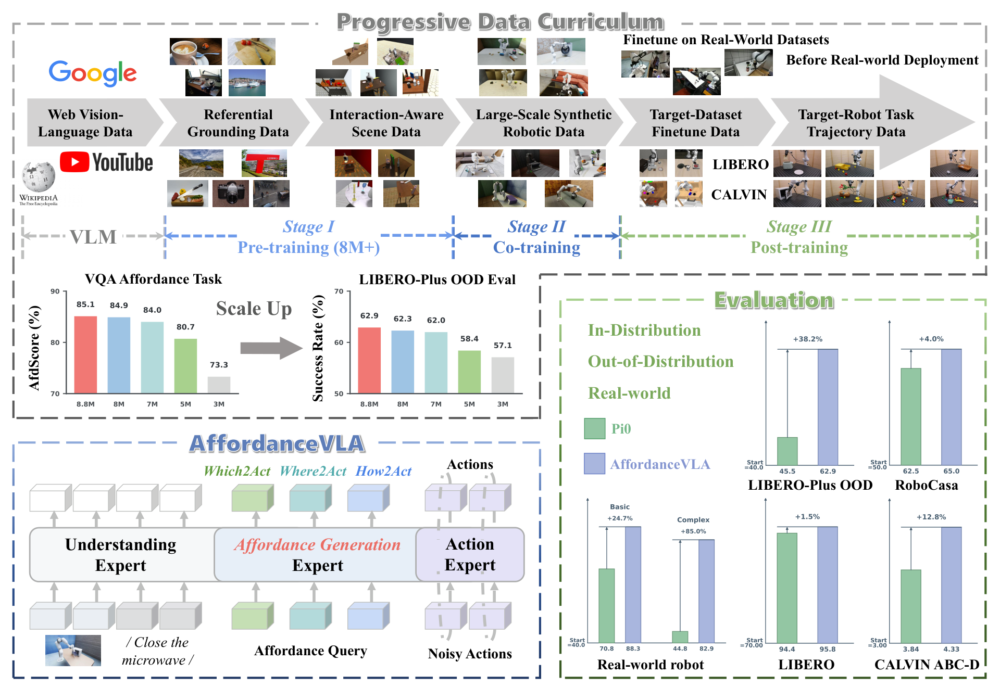
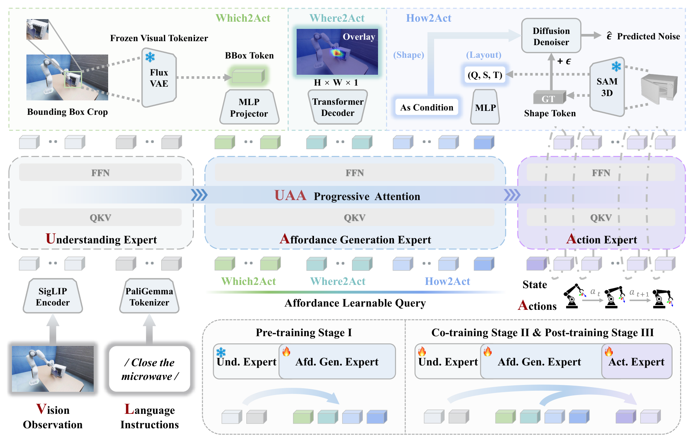
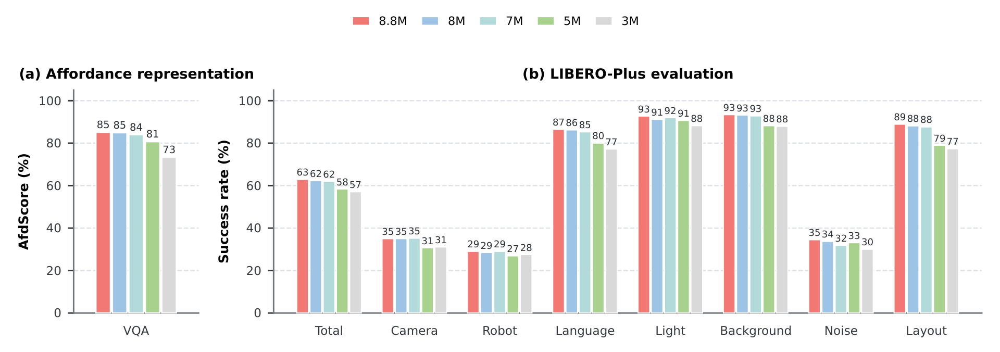
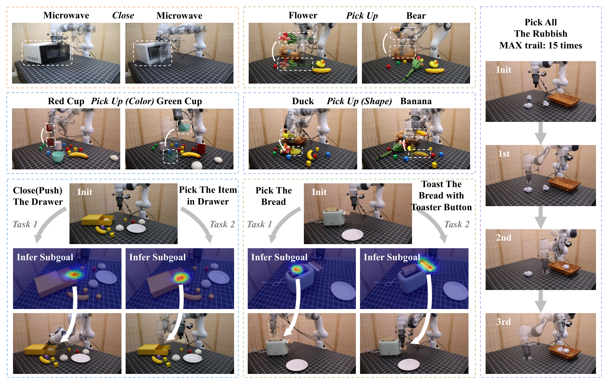

<div align="center">

## AffordanceVLA: Empowering Action Generation through Affordance-Aware Understanding

[](https://skywalker-yqz.github.io/AffordanceVLA/) [](https://arxiv.org/abs/2606.06155) [](LICENSE)

[Qize Yu](https://skywalker-yqz.github.io/)<sup>1,†</sup>, [Jiadi You](https://scholar.google.com/citations?hl=en&user=G5RR8WEAAAAJ)<sup>2,†</sup>, [Yuran Wang](https://wayrise.github.io/)<sup>1</sup>, [Jiaqi Liang](https://screatorx.github.io/SCreatorX/)<sup>1</sup>, [Bowen Ping](https://scholar.google.com/citations?hl=zh-CN&user=DjcKZdkAAAAJ)<sup>1</sup>, [Yang Tian](https://nimolty.github.io/homepage/)<sup>1</sup>, [Yue Chen](https://yuechen0614.github.io/)<sup>1</sup>, [Bohan Zhou](https://zhoubohan0.github.io/)<sup>1,3</sup>, [Wenxuan Song](https://songwxuan.github.io/)<sup>2</sup>, [Minghong Cai](https://onevfall.github.io/personal_page/)<sup>3</sup>, [Zeying Gong](https://zeying-gong.github.io/)<sup>2</sup>, [Ruihai Wu](https://warshallrho.github.io/)<sup>1</sup>, [Yinchuan Li](https://yinchuanll.github.io/)<sup>4</sup>, [Junwei Liang](https://junweiliang.me/)<sup>2,&#42;</sup>, [Yingcong Chen](https://www.yingcong.me/)<sup>2,&#42;</sup>

<sup>1</sup>Peking University &nbsp;&nbsp; <sup>2</sup>HKUST (GZ) &nbsp;&nbsp; <sup>3</sup>The Chinese University of Hong Kong &nbsp;&nbsp; <sup>4</sup>Knowin AI

<sup>†</sup>Equal contribution &nbsp;&nbsp; <sup>&#42;</sup>Corresponding authors

</div>



AffordanceVLA introduces **structured affordance forecasting** as a task-oriented intermediate representation that bridges vision, language, and action. It models manipulation priors through three complementary components — **Which2Act** (object-centric grounding via visual-latent prediction), **Where2Act** (2D interaction localization via affordance maps), and **How2Act** (3D geometric reasoning) — integrated into a **Mixture-of-Transformer (MoT)** architecture and trained with a three-stage progressive curriculum.

The framework is designed to scale affordance-centric vision-language supervision into stronger affordance representations and, in turn, scalable robot control. The latest evaluation covers ID and OOD simulation across LIBERO, CALVIN, RoboCasa, and LIBERO-Plus, together with real-world manipulation.

This repository contains the model, training, and the automated affordance-annotation pipeline. For results, qualitative demos, and analysis, please see the [project page](https://skywalker-yqz.github.io/AffordanceVLA/).

> **Key idea.** Affordances serve as a perfect bridge, seamlessly coupling spatial grounding in vision, semantic conditioning in language, and execution guidance in action.

## Method



The framework comprises three specialized experts coordinated by a unidirectional **Understanding–Affordance–Action (UAA) progressive attention**:

- **Understanding Expert** (M<sub>und</sub>, PaliGemma: SigLIP + Gemma) fuses the observation O<sub>t</sub> and instruction *l* into an instruction-aware multimodal representation h<sub>und</sub>.
- **Affordance Generation Expert** (M<sub>gen</sub>, Gemma + learnable queries) decodes h<sub>und</sub> into structured affordance tokens Â<sub>t</sub> (Which2Act, Where2Act, How2Act).
- **Action Expert** (M<sub>act</sub>, Gemma, flow matching) synthesizes the action chunk â<sub>t:t+k</sub> conditioned on h<sub>und</sub>, Â<sub>t</sub>, and proprioceptive state s<sub>t</sub>.

UAA attention is bidirectional within each expert and strictly causal across experts: the Affordance Generation expert attends to the Understanding expert only, and the Action expert attends to both. This keeps action information from leaking into the affordance prediction stage (`src/utils/model_utils.py::make_att_2d_masks`).

### Structured affordance knowledge

| Module | Role | Prediction target | Loss |
|--------|------|-------------------|------|
| **Which2Act** | Object-centric grounding | Continuous visual latent of the target crop (frozen Flux VAE) | MSE (Eq. 1, default; Smooth-L1 optional) |
| **Where2Act** | 2D interaction localization | Pixel-level affordance heatmap | BCE (Eq. 2) |
| **How2Act** | 3D geometric reasoning | 3D shape latent (diffusion) + 10-DoF layout | ε-prediction MSE + Smooth-L1 (Eqs. 3–4) |

```
L_which  = (1 / (C·H·W)) · Σ  || ẑ − z_q ||²                              # Eq. 1
L_where  = − (1 / (H·W)) · Σ  [ M·log σ(ŷ) + (1−M)·log(1−σ(ŷ)) ]          # Eq. 2
L_shape  = E_{t, ε} || ε − ε̂_θ(x_t, t, h_shape) ||²                       # Eq. 3
L_layout = (1/10) · Σ  SmoothL1( ŷ_layout , y_layout )                    # Eq. 4
```

The Which2Act loss is selected by `WHICH2ACT_FLUX_LOSS_TYPE` at the top of `src/models/which2act_decoder.py` (`"mse"` by default; `"smooth_l1"` is also available).

### Three-stage progressive training

| Stage | Data | Trained | Frozen |
|-------|------|---------|--------|
| **I — Affordance** | Curated 8.8M Grounding and Pointing samples | Affordance Generation expert, queries, decoders (including How2Act) | Vision Encoder, Understanding, Action |
| **II — Robotic Co-Training** | InternData-A1 (synthetic robot) | All experts + decoders; Vision Encoder fine-tuned at a lower LR | — |
| **III — Target Post-Training** | LIBERO / CALVIN | Same trainable set as Stage II | — |

`STAGE1_TRAIN_HOW2ACT` and `STAGE2_FREEZE_VISION_ENCODER` (top of `src/train.py`) control these toggles. By default Stage I trains the How2Act decoder, and Stages II/III fine-tune the vision encoder at `training.vision_encoder_lr`.

Stage I uses a cleaned **8.8M-sample subset** assembled from the following grounding and pointing pools. Parenthetical values are the native numbers of spatial-supervision records reported by each source, in millions; they describe the candidate source pools rather than the number of records consumed in Stage I.

| Grounding source | Native records (M) |
|------------------|-------------------:|
| Objects365 | 30.000 |
| Open Images V7 | 15.852 |
| Visual Genome | 5.400 |
| Flickr30K Entities | 0.276 |
| RefCOCO / RefCOCO+ / RefCOCOg | 0.388 |
| LVIS v1 | 2.200 |
| MS COCO | 2.500 |
| LLaVA-OneVision-2-Spatial | 4.000 |
| Ego4D-FHO | 0.091 |
| VISOR | 9.900 |
| MECCANO | 0.202 |
| GEM-250K(4M) | 0.200 |

| Pointing source | Native records (M) |
|-----------------|-------------------:|
| SA-1B | 1,100.000 |
| RefSpatial | 2.500 |
| PixMo-Points | 2.380 |
| PRISM | 0.412 |
| AGD20K | 0.020 |
| ACRONYM | 17.700 |
| RoboAfford | 1.900 |
| RoboInter-VQA / Data | 2.300 |
| RoboSpatial | 3.000 |
| HOI4D | 2.400 |
| H2O | 0.572 |
| EgoDex | 90.000 |



> **Scaling finding. Scalable VQA affordance supervision → stronger affordance representations → scalable robot control.**

### Model variants

The token allocation of the Affordance Generation expert is fully driven by the YAML config — no code changes required to switch between the variants below (each row shows the relevant fields under `model:` in the YAML).

| Variant | `which2act_num_tokens` | `where2act_num_tokens` | `how2act_shape_num_tokens` | `how2act_layout_num_tokens` | `how2act_num_tokens` (= shape + layout) | N<sub>gen</sub> | Which2Act encoder |
|---------|------------------------|------------------------|----------------------------|------------------------------|-----------------------------------------|------|----------------|
| Prev               | 64 | 16 |  30 | 2 |  32 | 112 | VQ-VAE  |
| AffordanceVLA-fast | 16 | 16 |  30 | 2 |  32 |  64 | Flux VAE |
| AffordanceVLA      | 64 | 64 | 256 | 4 | 260 | 388 | Flux VAE |

The shipped `configs/stage1.yaml` / `stage2.yaml` / `stage3 *.yaml` use the **AffordanceVLA** layout (64 / 64 / 256+4). Switch variants by editing the token fields above, keeping `how2act_num_tokens` equal to the sum of shape and layout tokens. The main configuration sets `control_wristtoken: false`. An optional wrist token group can be appended with `control_wristtoken: true`; it shares the Which2Act decoder and is supervised by the full wrist-camera image.

The Flux projection head maps each token to its corresponding latent patch, supporting both the fast and full layouts.

## Real-world deployment



The figure illustrates representative real-world manipulation rollouts. Robot control is built with [frankapy](https://github.com/iamlab-cmu/frankapy), a Python interface for Franka Emika Panda research arms. The policy uses closed-loop replanning with the first five actions of each predicted chunk.


## Installation

Create the model environment from a fresh Python 3.11 installation:

```bash
conda create -n affordancevla python=3.11 -y
conda activate affordancevla
python -m pip install torch==2.2.0 torchvision==0.17.0 --index-url https://download.pytorch.org/whl/cu121
python -m pip install -r env/requirements_core.txt
python -m pip check
```

See [`env/README.md`](env/README.md) for environment verification and optional simulator and service setup. H800 and H200 use the same CUDA model environment. Set the per-device microbatch to fit the available memory; the trainer derives gradient accumulation to preserve the configured effective batch size.

The paper's training recipe uses 16 NVIDIA H200 GPUs. Stage I, Stage II, and target-benchmark post-training use effective batch sizes of 3,072, 1,024, and 256, respectively.

## Pretrained weights

AffordanceVLA initializes from public pretrained weights:

| Weight | Download | Config key |
|--------|----------|------------|
| π0 base (MoT backbone init) | [lerobot/pi0_base](https://huggingface.co/lerobot/pi0_base) | `model.pretrained_path` |
| PaliGemma tokenizer | [google/paligemma-3b-pt-224](https://huggingface.co/google/paligemma-3b-pt-224) | `model.language_tokenizer_path` |
| Flux VAE — Which2Act encoder | [John6666/flux1-dev-fp8-flux · `/vae`](https://huggingface.co/John6666/flux1-dev-fp8-flux/tree/main/vae) | `model.which2act_flux_vae_path` |
| VQ-VAE — Which2Act encoder (legacy) | [vae_ch160v4096z32.pth](https://huggingface.co/FoundationVision/var/blob/2fc3ff144f97ddd12207727b60dd6b997bc4cb69/vae_ch160v4096z32.pth) | `model.which2act_vae_ckpt` |

**Which2Act backend switch** (`model.which2act_use_flux_vae`):
- `true`: continuous Flux VAE latent regression. The loss is selected by the `WHICH2ACT_FLUX_LOSS_TYPE` constant at the top of `src/models/which2act_decoder.py` (`"mse"` by default; `"smooth_l1"` available).
- `false` (legacy): discrete VQ-VAE codebook classification with CrossEntropy.

Set `model.which2act_flux_vae_path=null` (Flux mode) or `model.which2act_vae_ckpt=null` (VQ mode) to disable the Which2Act loss.

## Data & affordance-annotation pipeline

Stage I uses **8.8M** curated grounding and pointing samples, with native spatial supervision normalized into common affordance targets. Stage II uses the full **InternData-A1 simulation dataset**. Stage III fine-tunes on the target benchmark, **LIBERO** or **CALVIN**; real-world adaptation uses a curated **DROID** subset followed by task demonstrations.

The annotation pipeline in `src/datasets/preprocessing/` combines keyframe detection, instruction decomposition, visual grounding, SAM segmentation, and SAM-3D shape and layout prediction. Its targets supervise Which2Act, Where2Act, and How2Act jointly.

### Dataset interface

Dataset adapters return the `AffordanceSample` schema in `src/datasets/base_dataset.py`. The package provides image and heatmap conversion, action processing, sample constructors, collation, and distributed dataset mixing. Configure a dataset adapter with its Python `factory` and constructor `kwargs`, or register the named dataset class in `src.datasets`.

```yaml
data:
  datasets:
    - type: vqa
      factory: my_data.grounding.GroundingDataset
      kwargs:
        root: data/VQA
```

### Service startup

Run each service in its component environment:

```bash
# Rex-Omni and SAM
python -m src.services.rexomni_service \
    --port 7862 --preload \
    --model_path pretrained/rexomni-finetuned \
    --sam_checkpoint pretrained/sam_vit_h.pth

# SAM-3D
python -m src.services.sam3d_service --port 17861 --mode latent --preload
```

Configure the instruction and annotation model clients in `instruction_decomposition.py` and `keyframe_affordance_annotation.py`. Service endpoints and access tokens are supplied through environment variables.

## Training

All training is YAML-driven. Use `torchrun` for multi-GPU and CLI dotlist overrides for any field. `--mode train` uses the full data; `--mode debug` (default) uses a minimal subset for smoke tests.

The shipped training configs under `configs/`:

```
configs/
├── stage1.yaml                         # Stage I  (VQA / affordance grounding)
├── stage2.yaml                         # Stage II (robot co-training, InternData-A1)
├── stage3 CALVIN.yaml                  # Stage III (CALVIN fine-tune)
├── stage3 Libero.yaml                  # Stage III (LIBERO fine-tune)
└── debug_flux_vae.yaml                 # Smoke test for the Flux VAE pipeline
```

The configurations follow Appendix G of the paper. `batch_size` is the per-device microbatch; `effective_batch_size` includes all devices and gradient accumulation. Stage I runs for 300K optimizer updates with a cosine schedule. Stage II runs for 230K updates with a constant learning rate. LIBERO and CALVIN post-training use 20 epochs and cosine schedules. All stages use a base learning rate of 5 × 10⁻⁵.

```bash
# Stage I — affordance grounding pre-training
export PRETRAINED_ROOT="$PWD/pretrained"
torchrun --nproc_per_node=16 -m src.train --config configs/stage1.yaml --mode train \
    model.pretrained_path=$PRETRAINED_ROOT/pi0_base \
    model.language_tokenizer_path=$PRETRAINED_ROOT/paligemma-3b-pt-224 \
    model.which2act_flux_vae_path=$PRETRAINED_ROOT/flux_vae

# Stage II — robotic co-training (init from Stage I)
torchrun --nproc_per_node=16 -m src.train --config configs/stage2.yaml --mode train \
    model.pretrained_path=$PRETRAINED_ROOT/pi0_base \
    model.load_ckpt=outputs/stage1/checkpoint-300000 \
    model.language_tokenizer_path=$PRETRAINED_ROOT/paligemma-3b-pt-224 \
    model.which2act_flux_vae_path=$PRETRAINED_ROOT/flux_vae

# Stage III — target-task fine-tuning (init from Stage II)
torchrun --nproc_per_node=16 -m src.train --config "configs/stage3 CALVIN.yaml" --mode train \
    model.load_ckpt=outputs/stage2/checkpoint-230000
torchrun --nproc_per_node=16 -m src.train --config "configs/stage3 Libero.yaml" --mode train \
    model.load_ckpt=outputs/stage2/checkpoint-230000
```

### Loss weighting

The Affordance loss decomposes into four terms whose internal ratio is fixed at
`which : where : shape : layout = 5 : 5 : 5 : 2`. The action flow-matching loss
weight stays at `1.0`. The task-level coefficient multiplies the weighted affordance objective,
`L_afd = 0.1 L_which + 0.1 L_where + 0.1 L_shape + 0.04 L_layout`:

| Stage | λ<sub>afd</sub> : λ<sub>act</sub> | `which2act_loss_weight` | `where2act_loss_weight` | `how2act_shape_loss_weight` | `how2act_layout_loss_weight` |
|-------|---------------------|-------------------------|-------------------------|-----------------------------|------------------------------|
| Stage II  | 0.50 : 1 | 0.05 | 0.05 | 0.05 | 0.02 |
| Stage III | 0.15 : 1 | 0.015 | 0.015 | 0.015 | 0.006 |

In Stage I the action loss is inactive (no ground-truth actions); Stage I keeps the original 0.1 / 0.1 / 0.1 / 0.04 weights, which preserves the 5 : 5 : 5 : 2 internal ratio.

### Configuration notes

The paper also applies mild perturbations to the affordance features supplied to the Action Expert during policy training, while using the original predictions at inference. Select the application stage and strength according to training stability in your task-specific training loop. The repository does not include a built-in perturbation hook.

- `model.chunk_size` must equal `data.chunk_size` (the action attention mask is built from `model.chunk_size`).
- `control_wristtoken` is optional: when set, an extra wrist token group (sharing the Which2Act decoder) is appended; the wrist token is inactive in Stage I (no wrist data) and supervised by the full wrist image in Stage II/III.
- The Vision Encoder is fine-tuned at `training.vision_encoder_lr` in Stage II/III. To freeze it instead, set `STAGE2_FREEZE_VISION_ENCODER = True` at the top of `src/train.py`.
- Per-step delta-action limits (`pos_limit`, `ori_limit`) are not hard-coded; supply them in the YAML, calibrated from the source datasets at the chosen `frame_num`.

```bash
# Auto-resume from the latest checkpoint in output_dir (default behavior)
python -m src.train --config configs/stage1.yaml

# Graceful stop: training saves a checkpoint and exits after the current step
touch outputs/stage1/STOP
```

## Evaluation

We evaluate AffordanceVLA on LIBERO, CALVIN ABC→D, RoboCasa, LIBERO-Plus, and real-world manipulation. Use the benchmark's observation preprocessing and action conventions when connecting `AffordanceVLAPolicy` to an evaluation environment. The [project page](https://skywalker-yqz.github.io/AffordanceVLA/) and paper provide quantitative results and qualitative rollouts.

## Repository structure

```text
assets/                 Paper figures
configs/                Stage I–III training configurations
data/                   Dataset references and sample organization
env/                    Installation and dependency specifications
src/models/             MoT backbone and affordance decoders
src/policies/           Training and inference policy
src/processors/         Optimizer and training schedules
src/datasets/           Data interfaces and preprocessing
src/services/           Rex-Omni and SAM-3D service wrappers
LIBERO/                 LIBERO benchmark reference
calvin/                 CALVIN benchmark reference
Rex-Omni/               Rex-Omni reference
SAM3D/                  SAM-3D reference
```

## Explore more awesome affordance

- [A3D](https://skywalker-yqz.github.io/A3D/) — Dual-Arm Assembly (AAAI 2026 Oral)
- [PA3FF](https://pa3ff.github.io/) — Part-Aware 3D Feature Field (ICLR 2026)
- [DexGarmentLab](https://wayrise.github.io/DexGarmentLab/) — Dexterous Garment Manipulation (NeurIPS 2025 Spotlight)
- [DualAfford](https://hyperplane-lab.github.io/DualAfford/) — Collaborative Dual-Gripper Affordance (ICLR 2023)

<!-- ## TODO

- [x] Paper
- [x] Project page
- [x] Model and training code
- [x] Affordance-annotation / data-preprocessing pipeline code
- [ ] **Real-robot code** — release the `frankapy`-based deployment stack.
- [ ] Data and annotations
- [ ] Model weights -->

## Citation

If you find AffordanceVLA useful, please consider citing our [paper](https://arxiv.org/abs/2606.06155):

```bibtex
@misc{yu2026affordancevlavisionlanguageactionmodelempowering,
      title={{AffordanceVLA}: A Vision-Language-Action Model Empowering Action Generation through Affordance-Aware Understanding},
      author={Qize Yu and Jiadi You and Yuran Wang and Jiaqi Liang and Bowen Ping and Yang Tian and Yue Chen and Minghong Cai and Zeying Gong and Ruihai Wu and Yinchuan Li and Junwei Liang and Yingcong Chen},
      year={2026},
      eprint={2606.06155},
      archivePrefix={arXiv},
      primaryClass={cs.RO},
      url={https://arxiv.org/abs/2606.06155},
}
```

## Acknowledgements

The MoT backbone and flow-matching action expert build on the open-source VLA
ecosystem (π<sub>0</sub> / PaliGemma); the data pipeline integrates
[RexOmni](https://github.com/IDEA-Research/Rex-Omni), [Qwen3-VL](https://github.com/QwenLM/Qwen3-VL),
[SAM](https://github.com/facebookresearch/segment-anything), and [SAM-3D](https://github.com/facebookresearch/sam-3d-objects).
The LIBERO evaluation setup follows [openvla/openvla](https://github.com/openvla/openvla).

## License

Original AffordanceVLA contributions are released under the [MIT License](LICENSE).
Third-party code, software dependencies, pretrained models, and datasets retain
their respective licenses and terms. See [Third-party notices](THIRD_PARTY_NOTICES.md)
for attribution and component-specific terms, and the
[Python dependency license inventory](licenses/PYTHON_DEPENDENCIES.md) for declared packages.
